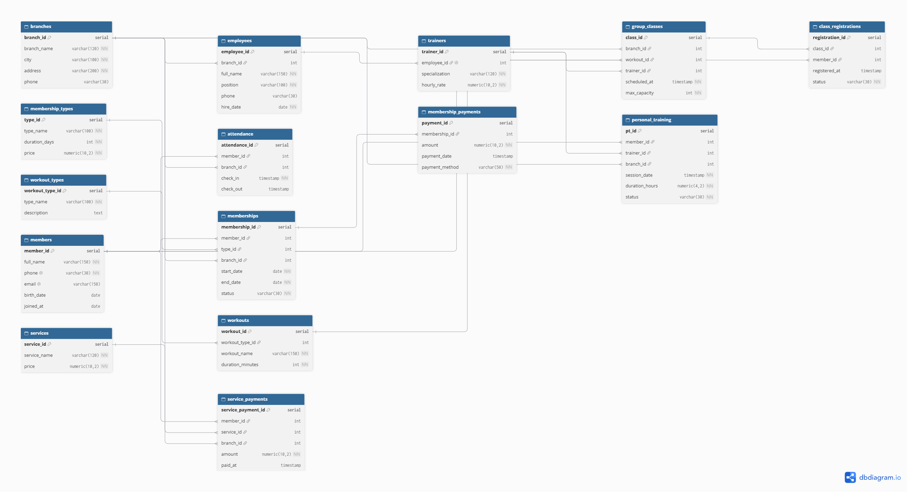

# Fitness Club Management System

Структура реляционной базы данных, тестовые данные, аналитические SQL-запросы и ER-диаграмма для системы управления фитнес-клубом (PostgreSQL).

## Состав проекта

- `schema.sql` — DDL-скрипт создания 15 таблиц с первичными и внешними ключами.
- `seed.sql` — тестовые данные по филиалам, сотрудникам, тренерам, клиентам, абонементам, оплатам, тренировкам, посещениям и допуслугам.
- `queries.sql` — аналитические SQL-запросы по доходам от абонементов и услуг, часовой нагрузке тренеров, посещаемости клиентов и заполняемости групповых занятий.
- `erd.png` — ER-диаграмма базы данных.

## Таблицы базы данных (15 таблиц)

1. `branches` — филиалы фитнес-клуба
2. `employees` — сотрудники клуба
3. `trainers` — тренеры, специализации и почасовые ставки
4. `members` — клиенты клуба
5. `membership_types` — типы абонементов, длительность и стоимость
6. `memberships` — оформленные абонементы клиентов и их статусы
7. `membership_payments` — оплаты за абонементы
8. `workout_types` — виды тренировок
9. `workouts` — программы и длительность тренировок
10. `group_classes` — расписание групповых занятий
11. `class_registrations` — записи клиентов на групповые занятия
12. `attendance` — журнал входов и выходов клиентов (турникет / посещения)
13. `personal_training` — персональные тренировки с тренерами
14. `services` — дополнительные услуги (сауна, шкафчик, InBody и др.)
15. `service_payments` — оплаты дополнительных услуг

## Как запустить

1. Выполнить `schema.sql` для создания всех 15 таблиц.
2. Выполнить `seed.sql` для заполнения базы тестовыми данными.
3. Запустить запросы из `queries.sql` для получения аналитических отчётов.

## ER-диаграмма

